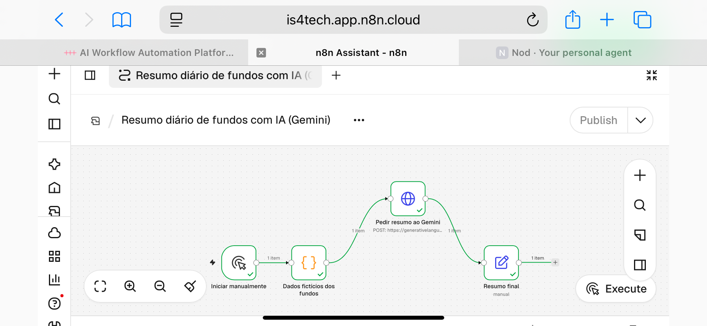
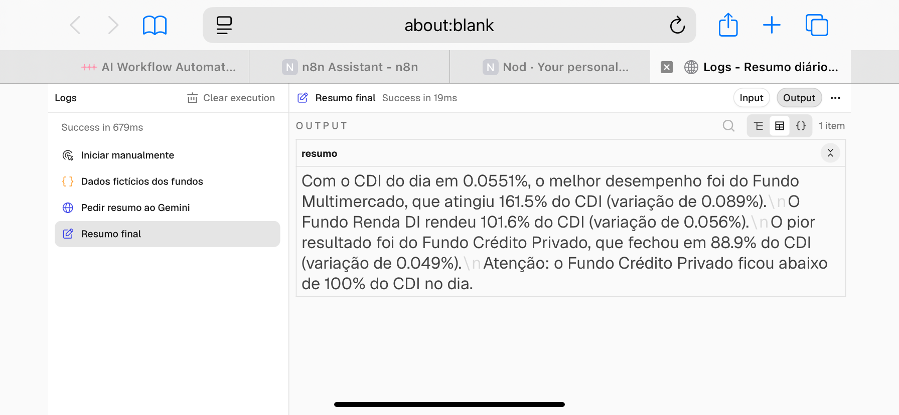

# Resumo diário de fundos com IA (n8n + Gemini)

Automação no n8n que pega dados de fundos de investimento, envia para um modelo de IA (Gemini) e recebe um resumo diário em texto, destacando o melhor e o pior fundo em relação ao CDI.

> Todos os dados são fictícios. O projeto foi inspirado numa rotina de acompanhamento de fundos na Tesouraria, mas não usa nenhum dado real.

## Problema

Acompanhar vários fundos todo dia exige olhar números, comparar com o CDI e escrever um resumo para o gestor. É uma tarefa repetitiva e sujeita a esquecimento.

## Como funciona

1. **Iniciar manualmente:** gatilho do fluxo.
2. **Dados fictícios dos fundos:** código em JavaScript que calcula o % do CDI de 3 fundos e monta o prompt.
3. **Pedir resumo ao Gemini:** requisição HTTP à API do Gemini com o prompt.
4. **Resumo final:** extrai o texto da resposta.

## Prompt usado

O prompt define o papel (analista de tesouraria), o formato (até 5 linhas, em português), o que destacar (melhor e pior fundo, alerta abaixo de 100% do CDI) e uma regra contra invenção de dados (usar apenas os números fornecidos).

## Resultado

## Como rodar

1. Crie uma conta no n8n e uma chave de API no Google AI Studio.
2. No n8n, importe o arquivo `workflow-resumo-fundos.json`.
3. No nó "Pedir resumo ao Gemini", crie uma credencial Header Auth com nome `x-goog-api-key` e, como valor, a sua chave.
4. Execute o fluxo.

A chave de API nunca fica dentro do arquivo do fluxo.

## Próximos passos

- Ler os dados de uma planilha (Google Sheets)
- Enviar o resumo por e-mail ou Telegram
- Agendar
